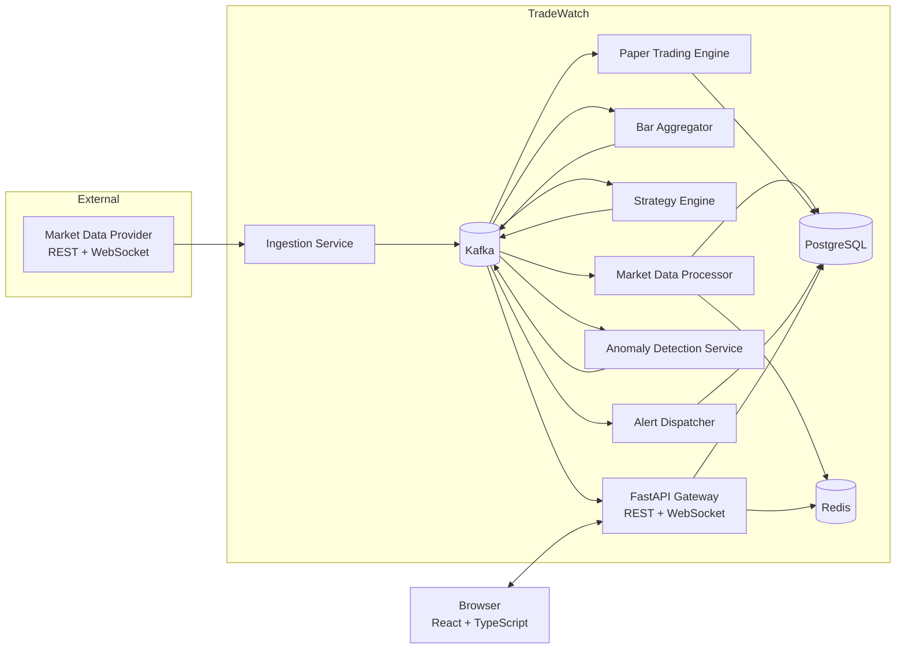
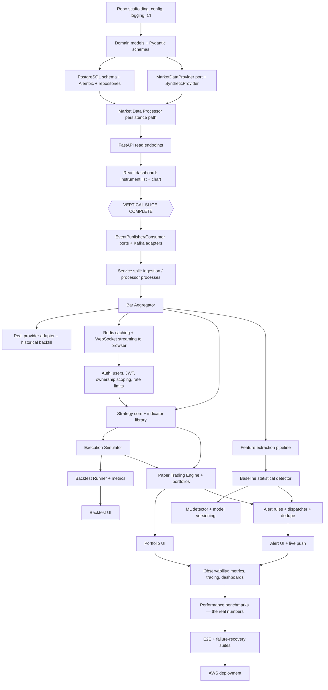

# TradeWatch — Architecture

**Status:** Draft 1 (pre-implementation)
**Last updated:** 2026-09-18
**Owner:** Youssef Elshafei

---

## 1. Purpose and Scope

TradeWatch is a market intelligence and paper-trading platform. It ingests live market
data, persists it, runs configurable trading strategies against both historical and live
data, simulates order execution, flags statistically unusual market activity, and exposes
all of this to a browser dashboard.

### 1.1 What this system is

- A **real-time data pipeline** (provider → normalization → event log → storage/consumers).
- A **research tool** (historical backtesting with an explicit execution model).
- A **simulation tool** (paper trading against live prices; no real money, no broker).
- A **monitoring tool** (statistical/ML detection of unusual market activity + alerting).

### 1.2 What this system is explicitly NOT

| Not | Why it matters |
| --- | --- |
| A real brokerage or order router | No venue connectivity, no real capital, ever. |
| A market-manipulation or financial-crime detector | The anomaly component detects *statistically unusual activity* relative to a symbol's own recent behaviour. It has no labelled ground truth and no validation against confirmed manipulation cases, and must never be described as detecting fraud, spoofing, or manipulation. See [ADR-0008](ADR/ADR-0008-anomaly-detection-approach.md). |
| A low-latency / HFT system | The target is "fast enough for a human dashboard" (sub-second end to end), not microseconds. |
| Financial advice | Strategy output is simulation output. |

### 1.3 Design principles

1. **Vertical slice first.** A thin end-to-end path (data in → database → API → chart on
   screen) exists before Kafka, before ML, before auth. Infrastructure is added when a
   concrete requirement forces it, never speculatively.
2. **Every technology earns its place.** Kafka ([ADR-0001](ADR/ADR-0001-kafka-as-the-event-backbone.md)),
   PostgreSQL ([ADR-0002](ADR/ADR-0002-postgresql-as-system-of-record.md)), and Redis
   ([ADR-0003](ADR/ADR-0003-redis-scope.md)) each have a written justification. If a
   component's justification collapses, the component goes.
3. **Ports before adapters.** External systems (market data provider, event bus, cache,
   notification channel) sit behind narrow interfaces, so tests run without them and
   swapping a provider is a contained change.
4. **Deterministic where it matters.** Strategy evaluation, backtesting, and execution
   simulation are pure and reproducible: same inputs + same seed → identical results.
5. **The database is the system of record.** Kafka is a transport and a replay buffer with
   finite retention, not durable truth. Redis is disposable.
6. **No invented numbers.** Every latency, throughput, or accuracy figure in the README, in
   documentation, or on a résumé must be produced by a benchmark in this repository, with
   its methodology and hardware recorded. Until measured, a number does not exist.

---

## 2. System Context



---

## 3. Components

Each component below is a separately runnable process with a single responsibility. In
early phases several of them run inside one process; the boundaries are drawn now so that
splitting them later is mechanical rather than a rewrite.

### 3.1 Market Data Ingestion Service

**Responsibility:** be the only part of the system that knows what an external provider
looks like.

- Maintains the provider connection (WebSocket subscription; REST polling as fallback).
- Normalizes provider-specific payloads into TradeWatch domain events.
- Assigns `event_id`, `ingested_at`, and the partition key.
- Publishes to Kafka. Publishes nothing else; writes to no database.
- Reconnects with exponential backoff and jitter, and re-subscribes on reconnect.
- Exposes liveness/staleness metrics (seconds since last message, per symbol).

**Explicitly not its job:** aggregation, business rules, or deduplication across restarts
(consumers are idempotent instead).

**Provider abstraction:** a `MarketDataProvider` port with at minimum
`stream_trades(symbols)`, `stream_quotes(symbols)`, `fetch_bars(symbol, interval, start, end)`,
and `list_instruments()`. Two implementations ship from day one:

- `SyntheticProvider` — a seeded random-walk generator plus deterministic replay of recorded
  fixtures. Used for all local development, CI, and load tests. No API key, no rate limit,
  no network.
- One real provider adapter — chosen later; see
  [ADR-0004](ADR/ADR-0004-market-data-provider-abstraction.md).

### 3.2 Market Data Processor

**Responsibility:** durably persist the canonical event stream.

- Consumes `tw.market.trades.v1`, `tw.market.quotes.v1`, and `tw.market.bars.1m.v1`.
- Validates against the event schema; malformed events go to the dead-letter topic and
  never crash the consumer.
- Writes to PostgreSQL in batches, idempotently (`ON CONFLICT (event_id) DO NOTHING`).
- Updates the Redis "latest quote/trade" hot keys.
- Commits Kafka offsets **after** the database write (at-least-once; duplicates are
  absorbed by the idempotent write).

### 3.3 Bar Aggregator

**Responsibility:** turn a trade stream into OHLCV bars.

- Consumes trades, maintains per-symbol open bars in memory, and closes a bar when the
  interval boundary passes — driven by event time, with a wall-clock grace period for late
  data.
- Emits `tw.market.bars.1m.v1`. Higher intervals (5m, 1h, 1d) are derived from 1m bars by
  rollup: in SQL for history, in the aggregator for live.
- Trades arriving after a bar closes produce a correction event rather than silently
  mutating a published bar.

It is separate from the Processor because it is stateful, and its failure mode (lost
in-memory bar state) differs from the Processor's (idempotent retry).

### 3.4 Strategy Engine

**Responsibility:** evaluate user-configured strategies and emit signals.

- A **Strategy** is a *parameterized configuration of a built-in strategy type*, not
  user-supplied code. See [ADR-0006](ADR/ADR-0006-strategies-as-configuration.md).
- The core contract is a pure function:
  `evaluate(state: StrategyState, bar: Bar) -> tuple[StrategyState, list[Signal]]`
  with no I/O, no clock access, and no ability to see data later than `bar`.
- The **same** strategy implementation is driven by two different drivers:
  - the **backtest driver**, replaying historical bars from PostgreSQL;
  - the **live driver**, consuming `tw.market.bars.1m.v1` from Kafka.

  This is the single most important structural decision in the trading half of the system
  ([ADR-0007](ADR/ADR-0007-shared-strategy-execution-core.md)): it is what makes a backtest
  a meaningful predictor of paper-trading behaviour.
- Emits `tw.signals.v1`. It does not size positions, place orders, or touch a portfolio.

### 3.5 Paper Trading Engine

**Responsibility:** turn signals into simulated portfolio state.

- Consumes `tw.signals.v1` for active deployments.
- Applies **position sizing** and **risk limits** (max position per symbol, max gross
  exposure, per-deployment cash, order-rate ceiling).
- Emits orders to `tw.orders.v1`, runs them through the **Execution Simulator**, emits fills
  to `tw.fills.v1`, and persists orders, fills, positions, and equity snapshots.
- The Execution Simulator is a library shared with the backtester: a fill model with
  configurable slippage (basis points), commission, and fill assumption (next-bar open by
  default). Backtest and paper trading disagreeing about a fill is a bug, not a nuance.

### 3.6 Backtest Runner

**Responsibility:** execute a historical simulation as a job.

- Reads a `backtest_runs` row, streams historical bars, drives the strategy core and the
  Execution Simulator, and writes trades, an equity curve, and summary metrics.
- Runs as a worker process, not inside the API request cycle; the API returns a run id and
  the client polls or subscribes.
- Guarantees no lookahead: the bar stream is a forward-only iterator, and indicators may
  only read state they have already accumulated.

### 3.7 Anomaly Detection Service

**Responsibility:** score market activity for statistical unusualness.

- Consumes bars (and optionally trades) and maintains a rolling feature window per symbol:
  return, realized volatility, volume z-score, trade-count z-score, quoted spread.
- Two tiers, in implementation order:
  1. **Baseline:** robust z-score (median / MAD) over a rolling window. Transparent, no
     training required, and the benchmark every later model must beat.
  2. **Model:** a scikit-learn `IsolationForest` (or equivalent unsupervised detector)
     trained offline on historical features, versioned as an artifact and loaded at startup.
- Emits `tw.anomalies.v1` carrying the score, the contributing feature values, the model
  version, and the threshold crossed — so every alert can be explained.
- The wording constraint is a hard requirement, not a style preference: the field is
  `anomaly_score`, the event is `anomaly.detected`, and UI copy says *unusual activity*.

### 3.8 Alert Dispatcher

**Responsibility:** match events against user alert rules and deliver notifications.

- Consumes `tw.anomalies.v1` and `tw.fills.v1`.
- Evaluates user-owned `alert_rules` (symbol filters, score thresholds, event types).
- Applies **deduplication and cooldown** per (rule, symbol), so one volatile morning does
  not produce four hundred notifications.
- Persists an `alerts` row, then publishes `tw.alerts.v1` for live push to the browser.
- Delivery channels are pluggable; in-app is the only one implemented initially.

### 3.9 API Gateway (FastAPI)

**Responsibility:** be the only component the browser talks to.

- REST for queries and commands; WebSocket for live market data, portfolio updates, and
  alerts.
- Owns authentication, authorization, rate limiting, request validation, and response
  shaping — and owns no business logic beyond that. It calls into the same service layer
  the workers use.
- Reads from Redis where a cache is justified, PostgreSQL otherwise.
- **The API is read-only with respect to market data.** There is no client-facing endpoint
  that writes ticks, bars, or anomalies; that write path exists only inside the trust
  boundary.

### 3.10 Frontend (React + TypeScript + Vite)

**Responsibility:** present the system and collect configuration.

- Views: instrument browser, live chart + tape, strategy editor, backtest results,
  paper-trading portfolio, anomaly feed, alert centre.
- Server state via a query cache (TanStack Query) plus a WebSocket subscription layer. No
  global state library until one is demonstrably needed.
- API types are **generated** from the FastAPI OpenAPI schema, so a backend contract change
  breaks the frontend build rather than production.

---

## 4. Data Flow

### 4.1 Live ingest path

**As built today (Phase 1).** The vertical slice is closed and runs end to end, with an
in-process event bus where Kafka will go:

```
SyntheticProvider (or Alpaca)
  → normalize to Trade/Quote/Bar event (+ deterministic event_id, ingested_at)
  → InMemoryEventBus                      ← Kafka replaces this in Phase 2 (ADR-0001)
  → Market Data Processor (batched, idempotent, one transaction per batch)
  → PostgreSQL
  → FastAPI  GET /api/v1/market/{symbol}/bars
  → React price chart
```

Because the bus is in-process, ingestion and processing must run in one process today —
`uv run tradewatch-pipeline`. That single constraint is the clearest statement of why
Phase 2 exists. See [docs/PIPELINE.md](docs/PIPELINE.md).

**The target, once Kafka lands:**

```
Provider WS message
  → normalize to Trade/Quote domain event (+ event_id, ingested_at)
  → publish to tw.market.trades.v1  (key = symbol)
      ├→ Market Data Processor → PostgreSQL (batched, idempotent) + Redis latest-tick
      ├→ Bar Aggregator → tw.market.bars.1m.v1
      └→ API WebSocket broadcaster → browser
```

### 4.2 Bar-driven path

```
tw.market.bars.1m.v1
  ├→ Market Data Processor → PostgreSQL bars
  ├→ Strategy Engine (live driver) → tw.signals.v1
  │     → Paper Trading Engine → risk checks → tw.orders.v1
  │         → Execution Simulator → tw.fills.v1 → PostgreSQL (orders, fills, positions)
  │             → Alert Dispatcher → alerts
  └→ Anomaly Detection Service → tw.anomalies.v1 → Alert Dispatcher → alerts
```

### 4.3 Backtest path (no Kafka)

```
POST /api/v1/backtests
  → backtest_runs row (status=queued)
  → Backtest Runner picks it up
  → stream bars from PostgreSQL
  → Strategy core → Execution Simulator → in-memory portfolio
  → persist backtest trades, equity curve, metrics (status=completed)
  → client polls GET /api/v1/backtests/{id} or listens on WebSocket
```

Backtesting deliberately bypasses Kafka: it is a batch job over data that already exists.
Routing it through a broker would add latency and failure modes for no benefit.

### 4.4 Time semantics

Three timestamps travel with every market event, and they are never conflated:

| Field | Meaning |
| --- | --- |
| `occurred_at` | Exchange/provider timestamp — when the thing happened. Drives all business logic, bar boundaries, and backtests. |
| `ingested_at` | When ingestion received it. Drives lag metrics. |
| `recorded_at` | Database insertion time (DB default). Drives auditing. |

Everything is UTC, stored as `timestamptz`, and serialized as RFC 3339. Local time exists
only in the browser's rendering layer.

---

## 5. Domain Entities

### 5.1 Market domain

- **Instrument** — a tradable symbol: `symbol`, `asset_class`, `exchange`, `currency`,
  `tick_size`, `lot_size`, `status`. The canonical reference list; everything else keys off it.
- **Trade** — an executed print: instrument, price, size, `occurred_at`, provider trade id.
- **Quote** — a top-of-book snapshot: bid/ask price and size, `occurred_at`.
- **Bar** — OHLCV over an interval: open, high, low, close, volume, trade count, VWAP,
  `interval`, `bar_start`. Closed bars are immutable.

### 5.2 Trading domain

- **Strategy** — a user-owned named configuration: `strategy_type` (e.g. `sma_crossover`,
  `rsi_reversion`, `breakout`), a validated `parameters` object, and a symbol universe.
- **StrategyDeployment** — a Strategy bound to a Portfolio and made live for paper trading.
  Lifecycle: `created → running → paused → stopped` (plus `errored`).
- **Signal** — strategy output: `direction` (`long`/`short`/`flat`), `strength`, the bar it
  was derived from, and a human-readable `reason` shown in the UI.
- **Portfolio** — a simulated account: starting cash, current cash, base currency, owner.
- **Order** — an intent: side, quantity, type (`market`/`limit`), status, source signal.
- **Fill** — an execution against an order: price, quantity, commission, slippage, `filled_at`.
- **Position** — the current holding per (portfolio, instrument): quantity, average entry
  price, realized and unrealized P&L.
- **EquityPoint** — a portfolio equity snapshot at a timestamp; the equity curve.
- **BacktestRun** — parameters (strategy, symbols, date range, initial cash, execution
  settings), status, and computed metrics (total return, CAGR, max drawdown, Sharpe, win
  rate, trade count, exposure).

### 5.3 Detection and alerting domain

- **AnomalyDetection** — instrument, `detected_at`, `anomaly_score`, `severity`,
  `model_name`, `model_version`, and the `features` snapshot that produced the score.
- **ModelVersion** — a trained artifact with its training window, hyperparameters, and
  offline metrics.
- **AlertRule** — user-owned: event types, symbol filter, thresholds, cooldown, channels.
- **Alert** — a fired rule instance: rule, triggering entity, message, severity,
  `acknowledged_at`.

### 5.4 Identity domain

- **User** — email, hashed password, status, role.
- **RefreshToken** — hashed token, expiry, revocation, device metadata.
- **AuditLogEntry** — actor, action, resource, timestamp, request id.

---

## 6. PostgreSQL Schema (Conceptual)

Conceptual, not DDL — column lists are indicative, and Alembic migrations become the source
of truth once implementation starts. Monetary and quantity values are `NUMERIC`, never
floating point ([ADR-0009](ADR/ADR-0009-decimal-money-representation.md)).

### 6.1 Reference and market data

```
instruments
  id PK, symbol UNIQUE, asset_class, exchange, currency,
  tick_size NUMERIC, lot_size NUMERIC, status, first_seen_at, metadata JSONB

trades                                    -- high volume, append-only
  id PK, event_id UUID UNIQUE, instrument_id FK,
  price NUMERIC(18,8), size NUMERIC(18,8),
  occurred_at timestamptz, ingested_at timestamptz, recorded_at timestamptz DEFAULT now(),
  provider, provider_trade_id
  INDEX (instrument_id, occurred_at DESC)

quotes                                    -- high volume, append-only
  id PK, event_id UUID UNIQUE, instrument_id FK,
  bid_price, bid_size, ask_price, ask_size NUMERIC(18,8),
  occurred_at, ingested_at
  INDEX (instrument_id, occurred_at DESC)

bars                                      -- the main read surface for charts + backtests
  instrument_id FK, interval, bar_start timestamptz,
  open, high, low, close, volume, vwap NUMERIC(18,8), trade_count INT,
  is_final BOOL, revision INT,
  PRIMARY KEY (instrument_id, interval, bar_start)
```

`bars` uses a natural composite primary key because that is exactly the uniqueness the
domain requires, and it makes upsert-on-replay trivial. `trades` and `quotes` carry a
surrogate `id` plus `UNIQUE(event_id)`, which is the idempotency guard for at-least-once
Kafka delivery.

**Growth plan (deferred, not now):** `trades` and `quotes` grow fastest. Native range
partitioning by month, a retention job, and possibly TimescaleDB are the escalation path —
but only after a measurement shows a real problem. See §15 (D4).

### 6.2 Trading

```
users
  id PK, email CITEXT UNIQUE, password_hash, role, status, created_at, last_login_at

refresh_tokens
  id PK, user_id FK, token_hash UNIQUE, expires_at, revoked_at, user_agent, ip

strategies
  id PK, user_id FK, name, strategy_type, parameters JSONB, symbols TEXT[],
  is_archived, created_at, updated_at
  UNIQUE (user_id, name)

portfolios
  id PK, user_id FK, name, base_currency, initial_cash NUMERIC, cash_balance NUMERIC,
  created_at

strategy_deployments
  id PK, strategy_id FK, portfolio_id FK, status, position_sizing JSONB,
  risk_limits JSONB, execution_config JSONB, started_at, stopped_at, error_message

orders
  id PK, portfolio_id FK, instrument_id FK, deployment_id FK NULL,
  client_order_id UNIQUE, side, order_type, quantity NUMERIC, limit_price NUMERIC NULL,
  status, signal_id NULL, created_at

fills
  id PK, order_id FK, price NUMERIC, quantity NUMERIC,
  commission NUMERIC, slippage_bps NUMERIC, filled_at

positions
  portfolio_id FK, instrument_id FK, quantity NUMERIC, avg_entry_price NUMERIC,
  realized_pnl NUMERIC, updated_at,
  PRIMARY KEY (portfolio_id, instrument_id)

equity_points
  portfolio_id FK, as_of timestamptz, cash NUMERIC, positions_value NUMERIC,
  total_equity NUMERIC,
  PRIMARY KEY (portfolio_id, as_of)

backtest_runs
  id PK, user_id FK, strategy_id FK, symbols TEXT[], start_date, end_date,
  initial_cash NUMERIC, execution_config JSONB, status, error_message,
  metrics JSONB, started_at, completed_at

backtest_trades
  id PK, backtest_run_id FK, instrument_id FK, side, quantity, entry_price, exit_price,
  entry_at, exit_at, pnl NUMERIC, return_pct NUMERIC

backtest_equity_points
  backtest_run_id FK, as_of, total_equity NUMERIC,
  PRIMARY KEY (backtest_run_id, as_of)
```

Positions are a **derived projection** of fills. They are stored for query speed, but
`fills` is the truth, and a rebuild job must be able to regenerate every position row from
fills alone. That property is a test, not a hope.

### 6.3 Detection and alerting

```
anomaly_detections
  id PK, instrument_id FK, detected_at, window_start, window_end,
  anomaly_score NUMERIC, severity, model_name, model_version, features JSONB
  INDEX (instrument_id, detected_at DESC)

model_versions
  id PK, model_name, version, trained_at, training_window_start, training_window_end,
  hyperparameters JSONB, offline_metrics JSONB, artifact_uri, is_active
  UNIQUE (model_name, version)

alert_rules
  id PK, user_id FK, name, event_types TEXT[], symbols TEXT[] NULL,
  conditions JSONB, cooldown_seconds INT, channels TEXT[], is_enabled

alerts
  id PK, alert_rule_id FK, user_id FK, event_type, instrument_id FK NULL,
  severity, title, body, payload JSONB, created_at, acknowledged_at, dedupe_key
  UNIQUE (alert_rule_id, dedupe_key)

audit_log
  id PK, user_id FK NULL, action, resource_type, resource_id, request_id,
  ip, created_at, details JSONB
```

---

## 7. Kafka Topics and Event Types

### 7.1 Envelope

Every message on every topic shares one envelope. The payload differs; the envelope never does.

```json
{
  "event_id": "018f3a2c-....",
  "event_type": "market.trade",
  "schema_version": 1,
  "occurred_at": "2026-09-18T13:45:02.118Z",
  "ingested_at": "2026-09-18T13:45:02.164Z",
  "producer": "ingestion-service@1.4.0",
  "correlation_id": "018f3a2c-....",
  "payload": {}
}
```

- `event_id` is **derived from the event's own data**, so normalizing the same trade twice
  produces the same id twice and `UNIQUE (event_id)` absorbs duplicates that originate at the
  provider — a reconnect replay, an overlapping backfill, a restart. See
  [ADR-0012](ADR/ADR-0012-deterministic-event-identity.md), which amends this section: an
  earlier draft specified UUIDv7 here, which cannot deduplicate anything because a fresh one
  is generated each time. UUIDv7 remains the rule for entity primary keys.
- `correlation_id` is inherited by every derived event, so a browser alert can be traced
  back to the exact trade print that caused it.
- Serialization is **JSON with Pydantic models and an explicit `schema_version`**. Avro and
  a Schema Registry are deliberately deferred — see
  [ADR-0005](ADR/ADR-0005-json-event-serialization.md).

### 7.2 Topics

Naming: `tw.<domain>.<entity>[.<qualifier>].v<major>`. A breaking schema change means a new
topic with an incremented major version and a dual-write window — never a silent
redefinition.

| Topic | Key | Produced by | Consumed by | Retention |
| --- | --- | --- | --- | --- |
| `tw.market.trades.v1` | `symbol` | Ingestion | Processor, Bar Aggregator, API broadcaster | 7d |
| `tw.market.quotes.v1` | `symbol` | Ingestion | Processor, API broadcaster | 24h |
| `tw.market.bars.1m.v1` | `symbol` | Bar Aggregator | Processor, Strategy Engine, Anomaly Detector, API broadcaster | 30d |
| `tw.signals.v1` | `deployment_id` | Strategy Engine | Paper Trading Engine, API broadcaster | 30d |
| `tw.orders.v1` | `portfolio_id` | Paper Trading Engine | Processor, API broadcaster | 30d |
| `tw.fills.v1` | `portfolio_id` | Paper Trading Engine | Processor, Alert Dispatcher, API broadcaster | 30d |
| `tw.anomalies.v1` | `symbol` | Anomaly Detector | Alert Dispatcher, API broadcaster | 30d |
| `tw.alerts.v1` | `user_id` | Alert Dispatcher | API broadcaster | 7d |
| `tw.dlq.v1` | original key | any consumer | operator / replay tool | 30d |

**Keying is a correctness decision, not a performance one.** Keying market topics by
`symbol` guarantees per-symbol ordering, which the Bar Aggregator and every strategy depend
on. Keying `tw.signals.v1` by `deployment_id` guarantees that one deployment's signals are
processed in order, so its position never inverts.

### 7.3 Event types

```
market.trade          { symbol, price, size, provider_trade_id, conditions[] }
market.quote          { symbol, bid_price, bid_size, ask_price, ask_size }
market.bar.closed     { symbol, interval, bar_start, o, h, l, c, volume, vwap, trade_count }
market.bar.corrected  { symbol, interval, bar_start, revision, ...same fields }
strategy.signal       { deployment_id, strategy_id, symbol, direction, strength, reason, bar_start }
order.submitted       { order_id, portfolio_id, symbol, side, quantity, order_type, limit_price }
order.rejected        { order_id, portfolio_id, reason_code, reason }
order.filled          { order_id, fill_id, portfolio_id, symbol, price, quantity, commission, slippage_bps }
anomaly.detected      { symbol, anomaly_score, severity, model_name, model_version, features{}, threshold }
alert.raised          { alert_id, user_id, event_type, severity, title, body, payload{} }
```

### 7.4 Delivery semantics

- **At-least-once**, everywhere. Exactly-once via Kafka transactions is not worth its
  complexity here, and would not remove the need for idempotent writes anyway.
- Every consumer is **idempotent**: unique constraints on `event_id`, upserts on natural
  keys, `client_order_id` for orders.
- Offsets are committed **after** the side effect, never before.
- One consumer group per logical consumer, named for its job: `processor-persist`,
  `bar-aggregator`, `strategy-engine`, `anomaly-detector`, `alert-dispatcher`,
  `ws-broadcaster`.
- A poison message is retried a bounded number of times, then published to `tw.dlq.v1` with
  the original headers, the consumer group, the error, and the failure count. A consumer
  never blocks a partition forever on one bad message.

---

## 8. API Boundaries

Base path `/api/v1`. The version lives in the path; a v2 may coexist with v1.

### 8.1 REST surface

| Area | Endpoints | Notes |
| --- | --- | --- |
| Auth | `POST /auth/register`, `/auth/login`, `/auth/refresh`, `/auth/logout`; `GET /auth/me` | |
| Instruments | `GET /instruments`, `GET /instruments/{symbol}` | Cached |
| Market data | `GET /market/{symbol}/bars?interval&start&end`, `GET /market/{symbol}/trades`, `GET /market/{symbol}/quote` | Read-only, paginated, hard result caps |
| Strategies | `GET|POST /strategies`, `GET|PATCH|DELETE /strategies/{id}` | Owner-scoped |
| Backtests | `POST /backtests`, `GET /backtests`, `GET /backtests/{id}`, `GET /backtests/{id}/trades`, `GET /backtests/{id}/equity` | Async job; 202 + run id |
| Portfolios | `GET|POST /portfolios`, `GET /portfolios/{id}`, `.../positions`, `.../orders`, `.../fills`, `.../equity` | Owner-scoped |
| Deployments | `POST /deployments`, `POST /deployments/{id}/start|pause|stop`, `GET /deployments` | Paper-trading control |
| Anomalies | `GET /anomalies?symbol&since&min_score` | Read-only |
| Alerts | `GET|POST /alert-rules`, `GET /alerts`, `POST /alerts/{id}/ack` | Owner-scoped |
| Ops | `GET /health` (liveness), `GET /ready` (dependency checks), `GET /metrics` (Prometheus) | `/metrics` is not public |

### 8.2 WebSocket surface

| Channel | Auth | Payload |
| --- | --- | --- |
| `/ws/market?symbols=AAPL,MSFT` | Authenticated | `market.trade`, `market.quote`, `market.bar.closed` |
| `/ws/portfolio/{id}` | Authenticated **and** owner | `order.*`, `order.filled`, equity updates |
| `/ws/alerts` | Authenticated | `alert.raised`, for that user only |

Protocol: the client sends `{"action":"subscribe","channel":...,"params":{...}}`, and the
server validates the subscription against the caller's permissions before attaching it. A
subscription the user may not have is rejected at subscribe time, not filtered later.

### 8.3 Cross-cutting API rules

- All request and response bodies are Pydantic models. The OpenAPI schema is generated and
  committed, and the frontend's TypeScript types are generated from it in CI.
- Errors use one envelope: `{"error": {"code", "message", "details", "request_id"}}`.
- Every response carries `X-Request-ID`, propagated into logs and into the Kafka
  `correlation_id` of any event the request causes.
- List endpoints are cursor-paginated with a maximum page size;
  `GET /market/{symbol}/trades` additionally caps the time range.
- Money and quantities are serialized as **strings** in JSON, to avoid IEEE-754 damage in
  JavaScript.

---

## 9. Authentication and Authorization Boundaries

### 9.1 Trust zones

```
Zone 0 — Public internet:   browser, external market data provider
Zone 1 — Edge:              FastAPI gateway (the ONLY inbound door)
Zone 2 — Internal plane:    Kafka, workers, Redis, PostgreSQL
```

Nothing in Zone 2 is reachable from Zone 0. Workers expose no inbound HTTP surface beyond a
health endpoint bound to the internal network. Market data enters Zone 2 only through the
ingestion service's **outbound** connection.

### 9.2 Authentication

- Local email + password. Passwords hashed with **Argon2id** (bcrypt an acceptable
  fallback); never reversible, never logged.
- **Short-lived JWT access token** (~15 min, HS256 initially; asymmetric later if multiple
  verifiers appear) plus a **rotating refresh token** stored hashed in `refresh_tokens`
  ([ADR-0010](ADR/ADR-0010-authentication-model.md)).
  Refresh-token reuse detection revokes the whole token family.
- Access tokens are stateless; the revocation surface is the refresh token plus a short
  Redis denylist for emergency logout-everywhere.
- WebSocket authentication happens in the connection handshake, and the connection closes
  when the token expires — a long-lived socket must not outlive its credential.

### 9.3 Authorization

- **Roles:** `viewer` (read market data, no trading), `trader` (own strategies, portfolios,
  deployments, alerts), `admin` (operational endpoints; read-only across users).
- **Ownership is enforced in the data access layer, not in route handlers.** Every query for
  a user-owned resource takes an actor and filters by `user_id`, so a route that forgets
  cannot leak: the repository will not return another user's rows. This is the defence
  against IDOR, the most likely real vulnerability in a system like this.
- Per-user resource limits (max strategies, max concurrent backtests, max deployments, max
  symbols per deployment) are abuse control, and they are configurable.

### 9.4 Other security boundaries

- Rate limiting in Redis: per-IP on unauthenticated routes, per-user on authenticated ones,
  with tighter buckets on expensive routes (`POST /backtests`).
- Strategy parameters are validated against a per-strategy-type Pydantic schema with
  explicit bounds. No `eval`, no dynamic import, no user code execution — see ADR-0006.
- Secrets (provider API key, JWT signing key, DB credentials) come from the environment in
  development and a secret manager in AWS. No secret is ever committed; CI runs a secret
  scanner.
- CORS is an explicit allowlist. Security headers (HSTS, CSP, `X-Content-Type-Options`,
  frame-deny) are set at the edge.
- Dependency and container scanning run in CI (`pip-audit`, `npm audit`, Trivy).
- The provider API key lives in exactly one service (ingestion); no other component can
  reach the provider even if compromised.

---

## 10. Redis: Justified Uses

Redis is included for these specific jobs, each with an alternative it measurably beats:

| Use | Key shape | Why not PostgreSQL |
| --- | --- | --- |
| Latest quote/trade per symbol | `tw:quote:{symbol}` (hash) | Hit on every dashboard render and every WS connect; a point read of a mutable hot value. |
| Recent bar window for charts | `tw:bars:{symbol}:{interval}` (JSON string, short TTL) | The most repeated query in the app, identical across all users. |
| Rate limiting | `tw:rl:{scope}:{id}` (counter + TTL) | Needs atomic increment with expiry at high frequency; writing this to the DB is abuse of the DB. |
| WebSocket fan-out across API replicas | Pub/Sub `tw:ws:{channel}` | Needed the moment the API runs more than one process. |
| Refresh-token emergency denylist | `tw:revoked:{jti}` with TTL | Auto-expiring by nature. |
| Backtest job status for polling | `tw:backtest:{id}:status` | High-frequency polling of a fast-changing value. |

**Redis is explicitly not** the system of record, a job queue (Kafka is), a session store
(JWTs are stateless), or a cache for anything cheap to query. Every cached key has a TTL and
a documented invalidation trigger; nothing is cached without both. `TW_CACHE_ENABLED=false`
must leave the application fully correct — if a cache cannot be shown to reduce measured p95
latency, it is removed.

---

## 11. Testing Strategy

Tests exist to let the system be changed confidently, not to produce a coverage badge.

### 11.1 Layers

| Layer | Tooling | Scope | Speed target |
| --- | --- | --- | --- |
| **Unit** | pytest | Pure domain: indicators, strategy evaluation, execution simulator, position maths, feature extraction, schema validation. No I/O, no containers. | Whole suite < 10s |
| **Integration** | pytest + testcontainers | Real PostgreSQL, Redis, Kafka: repositories, migrations, consumer idempotency, cache behaviour. | < 3 min |
| **API / contract** | pytest + httpx ASGI transport, Schemathesis | Every endpoint: happy path, validation errors, authN, authZ (including cross-user access attempts), pagination limits. | < 1 min |
| **Frontend unit** | Vitest + React Testing Library + MSW | Components, hooks, money/time formatting, error and loading states. | < 1 min |
| **End-to-end** | Playwright against docker-compose with the synthetic provider | Register → log in → create strategy → run backtest → see results; start a paper deployment → watch a fill arrive live. | < 10 min |
| **Failure recovery** | pytest + docker control | Each scenario in §12 has a test. | < 10 min |
| **Performance** | k6 or Locust (API) + a custom ingestion harness | Produces the measured, recorded numbers. | Nightly / on demand |

### 11.2 Rules

- **Determinism is enforced.** The synthetic provider is seeded, the clock is injected and
  frozen in tests, and no test sleeps to wait for a condition — it polls a predicate with a
  timeout.
- **No mocking of the database.** Repository tests run against real PostgreSQL in a
  container; an in-memory SQLite substitute would be testing a different database.
- **Boundaries are faked; internals are not.** The market data provider port is faked;
  application services are exercised for real.
- **Financial maths gets property-based tests** (Hypothesis): P&L identities, position
  arithmetic under arbitrary fill sequences, and bar aggregation invariants
  (`low ≤ open, close ≤ high`; `volume = Σ trade sizes`).
- **A golden backtest** is committed: a fixed strategy over a fixed fixture dataset with an
  expected equity curve. Any unintended change to execution semantics fails it.
- **Security tests are first-class.** For every owner-scoped endpoint there is a test that
  user B receives 404 for user A's resource.
- CI gates on lint (ruff), format (ruff-format / prettier), types (mypy strict on the domain
  packages, `tsc --noEmit`), unit, integration, API, and frontend tests. E2E runs on pull
  requests to `main`; performance runs nightly.
- Coverage is reported and watched for regressions, with no hard percentage gate — a
  threshold encourages tests that assert nothing.

### 11.3 Performance measurement (what may be claimed)

Benchmarks live in `benchmarks/`; each writes a dated JSON result plus the machine spec.
Metrics to measure, once there is a system to measure:

- Ingest throughput: events/sec sustained from provider through Kafka to a committed DB write.
- End-to-end latency: provider timestamp → browser render, p50/p95/p99.
- API latency: p50/p95/p99 per endpoint at a stated concurrency, cached vs uncached.
- Backtest throughput: bars/sec for a stated strategy and window.
- Recovery time: consumer-lag drain after a 60s broker outage.

No number appears in the README until it comes out of one of these.

---

## 12. Failure Scenarios

| # | Failure | Detection | Designed response | Test |
| --- | --- | --- | --- | --- |
| F1 | Provider WebSocket drops | No message for N seconds; staleness gauge | Exponential backoff + jitter reconnect, re-subscribe, REST backfill for the gap | Kill the fake socket mid-stream; assert reconnect and gap backfill |
| F2 | Provider rate-limits (429) | HTTP status / error frames | Client-side token bucket, retry with backoff, degrade to fewer symbols | Fake provider returns 429s |
| F3 | Provider sends malformed data | Pydantic validation failure | Reject, count, publish to DLQ; never crash the ingester | Fuzz the normalizer |
| F4 | Kafka unavailable at publish | Producer errors | Bounded local buffer with backpressure; if the buffer fills, drop *quotes* first and log loudly — never block trade ingestion indefinitely | Stop the broker container mid-stream |
| F5 | Kafka unavailable to consumers | Consumer errors | Retry loop, no offset commit, resume from the last committed offset; no data loss within retention | Stop/start the broker; assert no gaps in the DB |
| F6 | Consumer crashes mid-batch | Process exit / health check | Offsets uncommitted → redelivery → idempotent writes absorb duplicates | `kill -9` mid-batch; assert identical row counts |
| F7 | Duplicate delivery | Normal at-least-once behaviour | `UNIQUE(event_id)` / upsert; no double-counted volume, no duplicate orders | Replay the same batch twice; assert identical state |
| F8 | PostgreSQL unavailable | Connection errors | Consumers pause and retry with backoff (lag grows, data stays safe in Kafka); API `/ready` returns 503 | Stop the DB container; assert recovery with no loss |
| F9 | Redis unavailable | Connection errors | **Degrade, never fail:** cache misses fall through to PostgreSQL; rate limiting fails closed on authenticated writes, open on reads | Stop Redis; assert the app still serves |
| F10 | Consumer lag grows unbounded | Lag metric over threshold | Alert; scale partitions/consumers; documented shedding order (quotes before trades) | Load test at 2× expected rate |
| F11 | Out-of-order / late market data | `occurred_at` earlier than the current bar start | Bounded lateness window; after close, emit `market.bar.corrected` rather than mutating history | Inject late trades in a fixture |
| F12 | Clock skew between services | Compare `ingested_at` to broker time | All business logic uses `occurred_at`; the wall clock is used only for timeouts | Skewed-clock unit test |
| F13 | Bar Aggregator restart loses open bars | Startup with empty state | Rebuild the current partial bar by replaying trades from the last committed offset | Restart mid-bar; assert the bar closes correctly |
| F14 | Strategy raises an exception | Exception during evaluation | Isolate per deployment: mark it `errored`, stop it, alert the owner; other deployments continue | Inject a throwing strategy |
| F15 | Runaway strategy (order storm) | Order rate per deployment | Hard per-deployment order-rate limit and max-position guard, enforced before the simulator | A strategy that signals every bar |
| F16 | Backtest hangs or OOMs | Job timeout, memory ceiling | Bounded row streaming (never load a full history into memory), per-run timeout, run marked `failed` with a reason | Backtest over an absurd range |
| F17 | Anomaly model artifact missing/corrupt | Load failure at startup | Fall back to the statistical baseline and alert; never start with no detector | Corrupt the artifact file |
| F18 | Alert storm during a volatile open | Alerts per rule per minute | Per-rule cooldown + dedupe key + per-user hourly cap with a digest | Feed a synthetic crash |
| F19 | Slow WebSocket client | Send-buffer high-water mark | Drop the slow client's backlog and send a resync marker; one slow browser cannot stall a broadcaster | Simulate a stalled reader |
| F20 | Migration fails on deploy | Alembic error | Migrations run as a separate gated step before app rollout; expand/contract pattern so old and new code both work mid-deploy | CI runs upgrade → downgrade → upgrade |

---

## 13. Deployment Topology

**Local (Phases 0–11):** docker-compose — postgres, redis, kafka (KRaft, single broker),
api, ingestion, workers, frontend dev server. One command up, seeded from the synthetic
provider, no external credentials required.

**AWS (Phase 12):** the *shape* is decided; the specific services are not (see §15). Managed
PostgreSQL, a managed cache, a managed or single-broker Kafka, containerized services,
secrets in a secret manager, the frontend as static assets behind a CDN, and structured logs
and metrics shipped to one place. A cost ceiling is a first-class requirement: the
deployment must run within a small monthly budget, or scale to zero between demos.

---

## 14. Component Dependency Graph

Implementation order. An arrow means *must exist and work before*.



**Critical path:** `A → B → C/D → E → F → G` is the vertical slice, and nothing else starts
until it runs. `I → J → K` (Kafka + bars) then unblocks three independent tracks — trading,
detection, and streaming — which can proceed in parallel.

**Hard ordering constraints worth calling out:**

- The Execution Simulator must exist before *either* the backtester or paper trading.
  Building it twice is exactly how the two silently diverge.
- Auth must land before any multi-user feature stores user data, or every table needs a
  retrofit migration and every endpoint an audit.
- The baseline detector must exist before the ML detector, because it is the model's
  benchmark. A model that cannot beat a rolling z-score is not worth shipping.
- Observability must precede benchmarking; you cannot measure what you have not
  instrumented.

---

## 15. Decisions Deliberately Not Made Yet

Recording these prevents both premature commitment and the illusion that they were
overlooked. Each names the trigger that should force the decision.

| # | Open decision | Why it can wait | Decide when |
| --- | --- | --- | --- |
| ~~D1~~ | ~~Which real market data provider~~ | **Closed.** Alpaca Market Data API v2, on free-tier WebSocket support, historical depth, and a licence permitting storage — see [ADR-0011](ADR/ADR-0011-alpaca-as-the-market-data-provider.md) | Decided 2026-09-19 |
| D2 | Asset classes beyond US equities (crypto, FX, options) | Each adds domain complexity: 24/7 sessions, contract specs, multi-currency | Only after equities works end to end |
| D3 | Avro/Protobuf + Schema Registry | One producer, one language, few topics | When a second producer language appears, or a breaking schema change bites |
| D4 | Table partitioning / TimescaleDB for `trades` | Real data volume is unknown | When a measured query p95 degrades, or a table crosses a stated row count |
| D5 | Stream processing framework (Kafka Streams, Flink, Faust) | Plain consumers are sufficient and far easier to test | When stateful joins or cross-symbol windowed aggregation is genuinely needed |
| D6 | Multi-broker Kafka / replication factor > 1 | Single-node KRaft is enough locally; RF is a deployment-time setting | At AWS deployment |
| D7 | AWS compute model (ECS Fargate vs EKS vs EC2 vs Lambda) | Depends on the final resource profile and cost ceiling | Phase 12, driven by measured resource use and budget |
| D8 | Managed Kafka (MSK) vs self-hosted vs Redpanda vs no Kafka in the cloud demo | MSK cost may exceed the budget | Phase 12, with a written cost comparison |
| D9 | Auth provider: keep in-house vs Cognito/Auth0 | In-house demonstrates the security work; managed demonstrates pragmatism | Phase 12, or when SSO/MFA is required |
| D10 | ML model family beyond IsolationForest (autoencoder, LSTM, change-point detection) | The baseline must be beaten first, with evidence | When the baseline's false-positive rate is measured and found wanting |
| D11 | Feature store / online-offline parity tooling | Feature extraction is currently shared code | When training/serving skew is actually observed |
| ~~D12~~ | ~~Charting library~~ | **Closed.** Recharts, chosen for SVG output that is assertable in jsdom — see [ADR-0013](ADR/ADR-0013-recharts-for-the-price-chart.md) | Decided 2026-09-21 |
| D13 | Frontend global state library | The query cache may be all that is needed | Only if cross-view client state appears that the query cache cannot hold |
| D14 | Notification channels beyond in-app (email, Slack, webhook, push) | In-app proves the dispatcher; channels are adapters | Phase 9+, when someone actually wants to be woken up |
| D15 | Multi-currency and FX conversion | A single base currency avoids an entire class of bugs | Only together with D2 |
| D16 | Short selling, margin, leverage, order types beyond market/limit | Long-only market/limit exercises the whole path | After paper trading is correct and tested |
| D17 | Strategy plugin system for user-supplied code | Requires real sandboxing; an enormous security surface | Probably never; revisit only with a hard isolation story |
| D18 | Horizontal scaling model (partition count, consumer replicas, API replicas) | Sizing requires measurement | After the Phase 10 benchmarks |
| D19 | Data retention and archival (S3 cold storage, downsampling) | Depends on the observed growth rate | When storage cost or query time becomes visible |
| D20 | Monorepo vs split repos; container registry layout | A monorepo is right for one developer now | If the project ever gains independent release cadences |

---

## 16. Assumptions That Must Remain Configurable

These are the things most likely to be wrong. None may be hard-coded; all are
environment/config values with documented defaults, validated at startup by a single typed
settings object (`TW_`-prefixed, Pydantic Settings).

### 16.1 Market and instruments

| Key | Default | Why it will change |
| --- | --- | --- |
| `TW_SYMBOLS` | a small watchlist | The universe grows |
| `TW_MARKET_TIMEZONE` + session hours | `America/New_York`, 09:30–16:00 | Other venues, other sessions, 24/7 assets |
| `TW_BASE_CURRENCY` | `USD` | Multi-currency later |
| `TW_BAR_INTERVALS` | `1m,5m,1h,1d` | Research needs vary |
| `TW_LATE_DATA_GRACE_SECONDS` | `5` | Provider-dependent |

### 16.2 Provider

`TW_PROVIDER` (`synthetic` | real), `TW_PROVIDER_API_KEY`, `TW_PROVIDER_BASE_URL`,
`TW_PROVIDER_RATE_LIMIT_PER_MIN`, `TW_PROVIDER_RECONNECT_MAX_BACKOFF_S`,
`TW_PROVIDER_STALENESS_THRESHOLD_S`, `TW_SYNTHETIC_SEED`.

### 16.3 Kafka

`TW_KAFKA_BOOTSTRAP`, `TW_KAFKA_TOPIC_PREFIX` (`tw`), per-topic partition count and
retention, `TW_CONSUMER_BATCH_SIZE`, `TW_CONSUMER_MAX_POLL_INTERVAL_MS`,
`TW_CONSUMER_MAX_RETRIES`, `TW_DLQ_ENABLED`.

### 16.4 Storage and cache

`TW_DATABASE_URL`, pool size and timeout, `TW_REDIS_URL`, a TTL per cache family
(`TW_CACHE_TTL_QUOTE_S`, `TW_CACHE_TTL_BARS_S`, `TW_CACHE_TTL_INSTRUMENTS_S`), and
`TW_CACHE_ENABLED` — a kill switch, so the cache can be disabled to prove it is only an
optimization.

### 16.5 Trading simulation

| Key | Default | Note |
| --- | --- | --- |
| `TW_EXEC_SLIPPAGE_BPS` | `2` | An assumption, not a fact |
| `TW_EXEC_COMMISSION_PER_SHARE` / `_PCT` | `0` | Venue-dependent |
| `TW_EXEC_FILL_MODEL` | `next_bar_open` | vs `current_close`, `vwap` |
| `TW_EXEC_ALLOW_PARTIAL_FILLS` | `false` | |
| `TW_INITIAL_CASH` | `100000` | |
| `TW_MAX_POSITION_PCT` | `0.25` | Risk limit |
| `TW_MAX_GROSS_EXPOSURE_PCT` | `1.0` | Risk limit |
| `TW_MAX_ORDERS_PER_MINUTE_PER_DEPLOYMENT` | `10` | Runaway guard (F15) |

Slippage, commission, and the fill model are **modelling assumptions that materially change
every backtest result**. They are therefore stored on each `backtest_run` and each
deployment, so a result can never be compared against one produced under different
assumptions without the difference being visible.

### 16.6 Anomaly detection

`TW_ANOMALY_WINDOW_BARS` (60), `TW_ANOMALY_BASELINE_Z_THRESHOLD` (3.5),
`TW_ANOMALY_MODEL_THRESHOLD`, `TW_ANOMALY_MIN_BARS_BEFORE_SCORING`,
`TW_ANOMALY_DETECTOR` (`baseline` | `model` | `both`), `TW_ANOMALY_MODEL_PATH`,
`TW_ANOMALY_FEATURES` (the enabled feature list). Thresholds are guesses until calibrated
against real data, and must be tunable without a redeploy.

### 16.7 Alerts

`TW_ALERT_COOLDOWN_SECONDS` (300), `TW_ALERT_MAX_PER_USER_PER_HOUR` (50),
`TW_ALERT_CHANNELS_ENABLED`.

### 16.8 Security

`TW_JWT_SECRET` / signing key, `TW_ACCESS_TOKEN_TTL_MIN` (15),
`TW_REFRESH_TOKEN_TTL_DAYS` (30), `TW_PASSWORD_MIN_LENGTH`, `TW_CORS_ORIGINS`,
`TW_RATE_LIMIT_ANON_PER_MIN`, `TW_RATE_LIMIT_USER_PER_MIN`,
`TW_MAX_BACKTESTS_PER_USER_CONCURRENT`, `TW_MAX_DEPLOYMENTS_PER_USER`,
`TW_REGISTRATION_ENABLED`.

### 16.9 Operational

`TW_ENV` (`local` / `ci` / `prod`), `TW_LOG_LEVEL`, `TW_LOG_FORMAT` (`json` / `console`),
`TW_METRICS_ENABLED`, `TW_API_PAGE_SIZE_DEFAULT` / `_MAX`, `TW_BACKTEST_TIMEOUT_SECONDS`,
`TW_WS_MAX_CONNECTIONS_PER_USER`, `TW_WS_SEND_BUFFER_LIMIT`.

---

## 17. Consistency Check

A short self-audit, because an architecture that contradicts itself is worse than none.

- Every component in §3 appears in the data flow (§4), reads or writes at least one topic
  (§7), and has at least one failure scenario (§12). ✔
- Every table in §6 is written by exactly one component and read by the API. ✔
- Every topic in §7.2 has a named producer and at least one named consumer. ✔
- Every entity in §5 maps to a table in §6. ✔
- The ordering requirements (per-symbol, per-deployment) are satisfied by the chosen
  partition keys. ✔
- At-least-once delivery is matched by an idempotency mechanism on every consumer. ✔
- Every technology in the stack has an ADR justifying it, or is a direct dependency of one
  that does. ✔
- No component depends on a component later than itself in §14. ✔
- No performance claim appears anywhere in this document. ✔

---

## 18. Related Documents

- [DEVELOPMENT_PLAN.md](DEVELOPMENT_PLAN.md) — phases, exit criteria, order of work.
- [ADR/](ADR/) — the decisions behind the above, with their alternatives and consequences.
