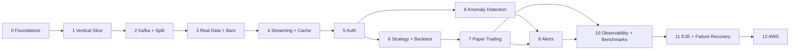

# TradeWatch — Development Plan

**Status:** Draft 1 (pre-implementation)
**Last updated:** 2026-09-18
**Companion to:** [ARCHITECTURE.md](ARCHITECTURE.md)

---

## How this plan works

Phases are ordered by **dependency**, not by how interesting they are. Each phase has:

- a **goal** — one sentence describing what becomes true;
- **deliverables** — what exists at the end;
- **exit criteria** — objectively checkable statements. If one is false, the phase is not
  done and the next phase does not start;
- **tests added** — the suite grows with the system, never after it;
- **explicitly deferred** — what is tempting to build here and must not be.

Three rules govern the whole plan:

1. **No phase begins before its predecessor's exit criteria are all true.** The one
   exception is the parallel tracks in Phases 6–9, which are explicitly marked.
2. **Every phase ends with the system running.** No phase leaves the repo in a state where
   `docker compose up` does not produce a working application.
3. **Every phase adds tests at its own level.** A phase that adds a Kafka consumer adds
   consumer integration tests in that same phase.

No time estimates are given. They would be invented, and this plan takes its own rule
against invented numbers seriously.

---

## Phase 0 — Foundations

**Goal:** the repository is a project, not a folder.

**Deliverables**

- Monorepo layout:
  ```
  backend/     tradewatch/{domain,application,infrastructure,api,workers}  tests/
  frontend/    src/  tests/
  ADR/         ARCHITECTURE.md  DEVELOPMENT_PLAN.md  README.md
  docker/      docker-compose.yml  Dockerfile.*
  benchmarks/
  .github/workflows/
  ```
  The backend package layout encodes the dependency rule that `domain` imports nothing from
  `infrastructure` — enforced later by an import-linter check in CI.
- Tooling: `uv` or Poetry, ruff (lint + format), mypy (strict on `domain` and
  `application`), pytest with markers (`unit`, `integration`, `api`, `e2e`, `slow`),
  pre-commit hooks.
- Frontend: Vite + React + TypeScript strict, ESLint, Prettier, Vitest.
- `docker-compose.yml` with postgres and redis only. Kafka is not in this phase.
- Typed settings object (`TW_`-prefixed Pydantic Settings) covering §16 of ARCHITECTURE.md,
  validated at startup, with `.env.example` documenting every key.
- Structured JSON logging with request/correlation id support.
- GitHub Actions: lint, typecheck, test, build — running on an empty-but-real test suite.
- ADRs 0001–0010 committed.

**Exit criteria**

- `docker compose up` starts postgres and redis; a health script confirms both.
- CI is green on a trivial commit.
- A missing required env var causes a startup failure with a clear message, proven by a test.
- `make test` / `pytest -m unit` runs in under 5 seconds.

**Explicitly deferred:** Kafka, auth, any business logic.

---

## Phase 1 — Vertical Slice — **COMPLETE**

**Goal:** synthetic market data reaches a chart in a browser, through a real database.

**Status:** closed. The path runs end to end and is covered by an end-to-end test that
checks provenance value by value. Deviations from the plan as written, both deliberate and
both documented: the full schema was built rather than three tables (see below), and bars
come from the provider's historical endpoint rather than from live aggregation, because the
aggregator is Phase 3. See [docs/PIPELINE.md](docs/PIPELINE.md).

This is the most important phase in the plan. It proves the whole shape of the system with
the smallest possible amount of infrastructure.

**Deliverables**

- **Domain models** (Pydantic): `Instrument`, `Trade`, `Quote`, `Bar`, plus the event
  envelope. Money as `Decimal` throughout (ADR-0009).
- **`MarketDataProvider` port** + `SyntheticProvider` (seeded random walk over a configured
  symbol list, deterministic given `TW_SYNTHETIC_SEED`).
- **`EventPublisher` / `EventConsumer` ports** with an **in-process implementation**. This
  is the seam Kafka slots into in Phase 2; it is not throwaway work, because it is also what
  makes every consumer unit-testable forever.
- **PostgreSQL schema**: built in full rather than the three tables originally planned for
  this phase — every table in `ARCHITECTURE.md` §6, with Alembic migrations and repositories
  (SQLAlchemy 2.0, async). See [docs/SCHEMA.md](docs/SCHEMA.md).

  The deviation is deliberate. §14's ordering constraint says *auth must land before any
  multi-user feature stores user data, or every table needs a retrofit migration*; creating
  `users` alongside the tables referencing it satisfies that at the schema level now, for
  the price of one migration instead of five. The authentication *logic* stays in Phase 5
  where ADR-0010 put it.
- **Market Data Processor** persistence path, with idempotent batch writes.
- **Minimal 1m bar aggregation**, in-process (the full stateful aggregator is Phase 3).
- **FastAPI**: `GET /health`, `GET /api/v1/instruments`,
  `GET /api/v1/market/{symbol}/bars`, `GET /api/v1/market/{symbol}/trades`.
  Committed OpenAPI schema.
- **React dashboard**: instrument list + a candlestick chart backed by the bars endpoint,
  polling. TypeScript types generated from OpenAPI.
- One `docker compose up` runs: postgres, redis, api (with the synthetic feed inside it),
  frontend.

**Exit criteria**

- Running compose and opening the dashboard shows a chart that updates as synthetic data
  arrives.
- The same seed produces the same data twice — proven by a test, not by eye.
- Restarting the stack loses no persisted bars.
- Unit + integration + API tests pass in CI; the unit suite stays under 10 seconds.
- Charting library chosen and recorded (decision D12 closed).

**Explicitly deferred:** Kafka, auth, WebSockets, strategies, ML, Redis caching.

---

## Phase 2 — Kafka Backbone and Service Split — **COMPLETE**

**Goal:** the components become independent processes communicating through a durable log.

**Why now:** Phase 1's in-process bus cannot survive a consumer restart, cannot replay,
cannot fan out to independent consumers with independent failure domains, and cannot be
scaled. Phase 3 onwards needs all four. This is the concrete requirement that justifies
Kafka (ADR-0001).

**Status:** closed. `tradewatch-producer` and `tradewatch-consumer` are separate processes
with Kafka between them; either can be restarted, or be absent, without the other losing an
event. See [docs/PIPELINE.md](docs/PIPELINE.md) for the topology, the delivery semantics and
the failure handling, and
[ADR-0014](ADR/ADR-0014-consumer-acknowledgement-and-dead-letter-policy.md) for the
acknowledgement boundary and the dead-letter policy.

**Delivered**

- Kafka (KRaft, single broker) in docker-compose, with auto-creation switched off.
- Topic creation with the partition counts and retention from ARCHITECTURE.md §7.2 — as an
  idempotent function the workers call at startup rather than a separate script, so a fresh
  clone needs no extra step and two workers racing cannot break.
- Kafka adapters behind the ports. `IngestionService` and `MarketDataProcessor` are
  unchanged, which is the proof the Phase 1 seam was drawn correctly. Two protocols were
  *added* — `EventBatchConsumer` and `DeadLetterSink` — because durable messaging
  acknowledges in batches and because quarantining is a transport concern the application
  has to be able to request without naming a broker (ADR-0014).
- Process split, with `tradewatch-producer` and `tradewatch-consumer` entrypoints.
- Idempotent consumption with offset-commit-after-write.
- Dead-letter topic handling. Placement is decided by **classification**, not by retry
  count: a permanent failure is quarantined on the first attempt, and a retryable one is
  never quarantined at all.
- An explicit, versioned event envelope with deterministic serialization.

**Not delivered, and why**

- **Consumer lag metrics.** Lag is visible through `kafka-consumer-groups --describe` and
  the consumer's own counters, but there is no metrics endpoint: Phase 10 owns Prometheus,
  and a metrics surface built here would be built twice.
- **A replay tool.** Replay *works* — a new consumer group reads a topic from the beginning,
  and an integration test asserts that doing so changes no stored data — but there is no
  command that replays from a given offset or timestamp. Deferred until something needs it;
  the obvious first customer is the Phase 3 aggregator, re-running a day of trades.
- **Dockerfiles and health endpoints for the workers.** The workers run on the host in
  development and the Compose `app` profile covers the API image. A worker health endpoint
  is worth having when something schedules the workers, which is Phase 12.

**Exit criteria**

| Criterion | Status |
| --- | --- |
| Restarting the consumer loses no events and creates no duplicates | **Met.** `test_a_restarted_consumer_does_not_re_read_what_it_finished` and `test_reprocessing_the_whole_topic_changes_nothing`, which compares stored values rather than row counts |
| Killing the broker and restarting it drains the lag with no gaps | **Met.** `test_an_outage_costs_lag_and_not_data` stops and starts the Compose container and asserts every event survives |
| A malformed event lands in the DLQ; the consumer keeps running | **Met.** With the original bytes and diagnostic headers |
| Replaying a topic twice produces identical table contents | **Met in substance, not literally.** Asserted against the same database rather than a fresh one: a second consumer group replays every message and the stored values are unchanged. A fresh-database comparison needs the replay tool above |
| All Phase 1 exit criteria still hold | **Met.** The Phase 1 in-process path still runs and is still tested |

**Explicitly deferred:** schema registry, multi-broker, exactly-once semantics, stream
processing frameworks.

---

## Phase 3 — Real Market Data and Historical Depth — **COMPLETE**

**Goal:** the system runs on real market data, and has enough history to backtest against.

**Status:** closed, with one honest caveat. The bar aggregator runs as its own service in its
own consumer group, the backfill is idempotent and resumable, and a month of 1-minute bars is
stored and passes the quality checks. The **real provider adapter has still never run against
the live Alpaca API**, because no credentials exist in this environment — it was validated by
reading it against its own documented constraints, which found three defects including one
that would have broken live streaming outright. `pytest -m provider` closes that gap and needs
a key pair. See [docs/BACKFILL.md](docs/BACKFILL.md),
[ADR-0015](ADR/ADR-0015-event-time-bar-aggregation.md) and
[ADR-0016](ADR/ADR-0016-idempotent-bar-aggregation-under-redelivery.md), which supersedes
0015's restart story after the aggregator was found to double every redelivered trade.

**Exit criteria**

| Criterion | Status |
| --- | --- |
| A month of 1m bars for the watchlist exists and passes the quality checks | **Met.** 172,800 bars across four symbols, no gaps, no invariant violations |
| Restarting the aggregator mid-bar produces a correct closed bar | **Met, after a fix.** Resuming was already asserted by comparison against an uninterrupted run. What those tests never did was redeliver a trade the previous run had already folded in — the thing a restart actually causes — and doing so doubled `volume`, `trade_count` and `vwap` while leaving OHLC perfect. Fixed by recording the consumer's stream position in the same transaction as the bars (ADR-0016). Now proven live: offsets rewound 3,000 × 3 partitions, 9,000 events redelivered, 9,000 skipped as already applied, and a checksum over every 1m bar identical before and after |
| Losing the provider connection reconnects automatically | **Met in code, unverified against the live service.** The Phase 1 `resilience` module is wired in and unit-tested; no credentials to prove it against Alpaca |
| With `TW_PROVIDER=synthetic` nothing about existing behaviour changes | **Met.** Synthetic remains the default and every Phase 1 and 2 test still passes |

**Deliverables**

- Decision D1 closed: a provider is chosen and the choice recorded as an ADR, with
  free-tier limits, WebSocket support, and data-storage licensing checked.
- The real `MarketDataProvider` adapter, behind the same port, selected by `TW_PROVIDER`.
- Rate limiting, reconnect with backoff, and staleness detection (F1, F2).
- **Historical backfill job:** fetch and store bars for a symbol/date range, idempotent and
  resumable, with gap detection and a gap-filling pass.
- **Full Bar Aggregator** as its own service: event-time bar closing, a lateness window,
  correction events, partial-bar rebuild on restart (F13), and accumulation that survives the
  redelivery a restart causes (F7, ADR-0016).
- Higher-interval rollups (5m, 1h, 1d) from 1m bars.
- Data quality checks: bar invariants, duplicate prints, gaps during market hours.

**Exit criteria**

- With `TW_PROVIDER=synthetic` nothing about the app's behaviour changes — the adapter swap
  is invisible above the port.
- A month of 1m bars for the configured watchlist is present and passes the data quality
  checks.
- Restarting the aggregator mid-bar produces a correct closed bar.
- Losing the provider connection for a period results in an automatic reconnect and a
  backfill of the gap, verified by a test.

**Explicitly deferred:** additional asset classes (D2), partitioning (D4).

---

## Phase 4 — Live Streaming and Caching

**Goal:** the dashboard is live rather than polling, and hot reads stop hitting PostgreSQL.

**Deliverables**

- WebSocket endpoint `/ws/market` with a subscribe/unsubscribe protocol and per-connection
  symbol subscriptions.
- A Kafka→WebSocket broadcaster inside the API process, with Redis Pub/Sub fan-out so the
  API can run more than one replica.
- Slow-consumer handling: buffer high-water mark, drop-and-resync (F19).
- Redis caching for the uses in ARCHITECTURE.md §10, each with a TTL and an invalidation
  trigger; `TW_CACHE_ENABLED=false` must leave the application correct.
- Frontend: live chart and trade tape over WebSocket, with reconnect and backfill-on-reconnect.

**Exit criteria**

- A trade published to Kafka appears in the browser without a page refresh.
- With `TW_CACHE_ENABLED=false` every test still passes — the cache is provably an
  optimization, not a dependency.
- Stopping Redis degrades performance but does not break the app (F9), proven by a test.
- Killing and restarting the WebSocket connection resyncs the chart with no gaps or
  duplicate bars.

**Explicitly deferred:** performance numbers — measurement is Phase 10, after
instrumentation. Do not put a latency figure in the README from this phase.

---

## Phase 5 — Authentication, Authorization, Multi-Tenancy

**Goal:** the system has users, and user-owned data is safe.

**Why here:** the next phase is the first that stores per-user records. Retrofitting
ownership onto existing tables and endpoints is far more expensive and far less safe than
building it before the tables exist.

**Deliverables**

- `users` and `refresh_tokens` tables; Argon2id password hashing.
- Register / login / refresh (with rotation and reuse detection) / logout / me.
- Roles `viewer` / `trader` / `admin`; FastAPI dependencies for the current actor.
- **Ownership enforcement in the repository layer** — every user-owned query takes an actor
  and filters by `user_id` (ARCHITECTURE.md §9.3).
- Redis rate limiting: per-IP anonymous, per-user authenticated, tighter on expensive routes.
- Security headers, CORS allowlist, secret scanning and dependency audit in CI.
- `audit_log` writes for security-relevant actions.
- Frontend: auth flow, token refresh, protected routes, 401/403 handling.

**Exit criteria**

- For every owner-scoped endpoint there is a test that user B gets 404 on user A's resource.
  This is a hard gate.
- Access-token expiry, refresh rotation, and reuse-detection revocation each have a test.
- Rate limits return 429 with a `Retry-After` header, under test.
- No secret appears in the repo; the CI secret scanner is green.
- An expired token closes an open WebSocket connection.

**Explicitly deferred:** OAuth/SSO/MFA, managed identity providers (D9).

---

## Phase 6 — Strategy Core and Backtesting

**Goal:** a user can define a strategy and run a reproducible historical simulation.

*Phases 6–9 depend on Phases 0–5. Within them, the trading track (6, 7) and the detection
track (8, 9) are independent and may be interleaved.*

**Deliverables**

- **Indicator library:** SMA, EMA, RSI, ATR, rolling volatility — pure, incremental,
  unit-tested against hand-computed fixtures.
- **Strategy core:** the pure `evaluate(state, bar) -> (state, signals)` contract, with
  built-in types `sma_crossover`, `rsi_reversion`, `breakout`, each with a Pydantic
  parameter schema with explicit bounds (ADR-0006).
- **Execution Simulator** (shared library, ADR-0007): slippage, commission, fill model,
  cash and position accounting.
- **Backtest Runner** worker: streams bars, drives the strategy and simulator, computes
  metrics (total return, CAGR, max drawdown, Sharpe, win rate, trade count, exposure),
  persists trades and the equity curve.
- API: strategy CRUD, backtest submit/list/get/trades/equity.
- Frontend: strategy editor with parameter validation, backtest submission, an equity-curve
  chart, a trade list, and a metrics panel.

**Exit criteria**

- **The golden backtest passes:** a committed strategy over a committed fixture dataset
  reproduces a committed equity curve exactly.
- Running the same backtest twice produces identical results, including the trade sequence.
- A lookahead test fails if a strategy is given access to a future bar — i.e. the guard
  itself is tested.
- Property-based tests on position and P&L arithmetic pass for arbitrary fill sequences.
- Changing `TW_EXEC_SLIPPAGE_BPS` changes the result *and* the stored `execution_config`
  on the run.

**Explicitly deferred:** parameter optimization/sweeps, walk-forward analysis, short
selling and margin (D16), user-supplied strategy code (D17).

---

## Phase 7 — Paper Trading

**Goal:** a strategy runs live against real market data and maintains a simulated portfolio.

**Deliverables**

- `portfolios`, `strategy_deployments`, `orders`, `fills`, `positions`, `equity_points`.
- **Strategy Engine live driver:** consumes `tw.market.bars.1m.v1`, restores per-deployment
  state on restart, emits `tw.signals.v1`.
- **Paper Trading Engine:** position sizing, risk limits, order-rate ceiling (F15), the
  shared Execution Simulator, and persistence of orders, fills, positions, and equity.
- Deployment lifecycle API: create / start / pause / stop, with per-deployment error
  isolation (F14).
- Position rebuild job: regenerate all positions from fills alone.
- Frontend: portfolio view, live positions and P&L, order and fill blotter, live equity curve.

**Exit criteria**

- **The consistency test passes:** the same strategy, over the same bars, produces the same
  fills whether run through the backtester or through the live paper path. This is the
  central claim of ADR-0007 and it must be enforced by a test, not by inspection.
- A deployment restart resumes without duplicating or losing orders.
- A strategy that raises an exception marks only its own deployment `errored`; others keep
  running.
- Risk limits reject orders that would breach them, with a recorded `reason_code`.
- Rebuilding positions from fills reproduces the stored positions exactly.

**Explicitly deferred:** real broker connectivity (never), advanced order types, portfolio
optimization.

---

## Phase 8 — Anomaly Detection

**Goal:** the system flags statistically unusual market activity, with an explanation.

**Deliverables**

- **Feature pipeline:** rolling per-symbol features (return, realized volatility, volume
  z-score, trade-count z-score, spread) — one implementation shared by training and serving,
  to avoid skew.
- **Baseline detector:** robust z-score (median/MAD), configurable threshold. Ships first
  and stays as the fallback.
- **Offline training pipeline:** build a feature dataset from historical bars, train an
  `IsolationForest`, evaluate, and version the artifact into `model_versions` with its
  training window, hyperparameters, and offline metrics.
- **Anomaly Detection Service:** consumes bars, scores, emits `anomaly.detected` with the
  contributing features and the threshold crossed; falls back to the baseline if the
  artifact is missing or corrupt (F17).
- API: `GET /anomalies`. Frontend: anomaly feed, score history, and a per-detection
  explanation panel.
- **A written model card** in `ADR/` or `docs/`, stating what the detector does, what it
  does not do, how it was evaluated, and its known limitations.

**Exit criteria**

- Injected synthetic anomalies (a volume spike, a price jump, a spread blow-out) are
  detected; a quiet period produces no detections.
- The ML detector is compared against the baseline on the same held-out data, and the
  comparison is written down. If it does not beat the baseline, the baseline stays the
  default — that outcome is an acceptable result, not a failure.
- Every detection stored can be explained from its own `features` payload.
- No text anywhere in the code, UI, docs, or commit messages claims detection of
  manipulation, fraud, or financial crime (ADR-0008). Checked by a grep-based test.

**Explicitly deferred:** deep-learning detectors (D10), a feature store (D11), online
learning, cross-symbol contagion detection.

---

## Phase 9 — Alerts and Notifications

**Goal:** users are told about the things they asked to be told about, and not more.

**Deliverables**

- `alert_rules` and `alerts` tables; rule evaluation for anomalies and fills.
- **Alert Dispatcher** with dedupe keys, per-rule cooldown, and a per-user hourly cap with
  a digest (F18).
- `tw.alerts.v1` → WebSocket `/ws/alerts` live push.
- API: alert-rule CRUD, alert list, acknowledge.
- Frontend: alert centre, unread indicator, live toasts, rule builder.

**Exit criteria**

- A synthetic market crash produces a bounded number of alerts, not hundreds — asserted by
  a test.
- A rule matching nothing produces nothing; a disabled rule produces nothing.
- Alerts are delivered only to their owner; a cross-user delivery test exists.
- Acknowledgement is idempotent.

**Explicitly deferred:** email/Slack/webhook/push channels (D14) — the channel abstraction
exists, the adapters do not.

---

## Phase 10 — Observability and Performance Measurement

**Goal:** the system can be seen, and its real numbers can be stated.

**Deliverables**

- Prometheus metrics across every service: ingest rate, consumer lag, processing latency
  per stage, DB pool usage, cache hit rate, WS connections, order and signal rates, error
  rates.
- Correlation-id propagation from the HTTP request through Kafka to the derived event; a
  distributed trace or its equivalent.
- A Grafana dashboard (or equivalent) committed to the repo.
- `/ready` checks each dependency independently.
- **Benchmarks in `benchmarks/`**, each recording methodology, configuration, hardware, and
  a dated JSON result:
  - ingest throughput (events/sec sustained to a committed DB write);
  - end-to-end latency (provider timestamp → browser), p50/p95/p99;
  - API latency per endpoint at a stated concurrency, cached vs uncached;
  - backtest throughput (bars/sec);
  - recovery time (lag drain after a 60s broker outage).
- A `PERFORMANCE.md` reporting what was measured, under what conditions, and what it does
  not prove.

**Exit criteria**

- Every number that will ever be quoted about TradeWatch — in the README, in documentation,
  in an interview, on a résumé — traces to a benchmark in this repository, with its
  conditions attached.
- A benchmark can be re-run by another person from the documented command alone.
- Bottlenecks identified here are recorded, not silently optimized away without measurement
  before and after.

**Explicitly deferred:** optimization work that has not been justified by one of these
measurements.

---

## Phase 11 — End-to-End and Failure-Recovery Hardening

**Goal:** the failure behaviour described in ARCHITECTURE.md §12 is proven, not asserted.

**Deliverables**

- Playwright E2E suite: register → log in → browse instruments → create a strategy → run a
  backtest → inspect results → start a deployment → observe a live fill → receive an alert.
- A failure-injection harness that starts, stops, and pauses containers, and corrupts
  messages, from within tests.
- A test for **each** of F1–F20.
- A documented chaos runbook: what to do when each failure happens in a running deployment.
- Load test at a stated multiple of the expected rate, with the shedding order (F10)
  observed and recorded.

**Exit criteria**

- Every row of the §12 table has a test id in its Test column, and that test passes in CI.
- The E2E suite passes against a fresh `docker compose up` from an empty database.
- A full-stack cold start on a clean machine is documented and reproducible from the README.

---

## Phase 12 — AWS Deployment

**Goal:** the system runs somewhere other than a laptop, within a stated budget.

**Deliverables**

- Decisions D6, D7, D8, D9 closed, each with a written comparison including cost.
- Infrastructure as code (Terraform or CDK) — no click-ops.
- Managed PostgreSQL and cache; Kafka per D8; containerized services; secrets in a secret
  manager; the frontend as static assets behind a CDN.
- CD pipeline: build, scan, migrate (gated), deploy, smoke test, with a rollback path.
- Centralized logs and metrics; a minimal alerting policy for the deployment itself.
- A cost report and a documented scale-to-zero or teardown procedure.

**Exit criteria**

- A clean deployment from an empty account is reproducible from the IaC alone.
- Migrations run as a separate gated step, with rollback tested (F20).
- The monthly cost is measured and recorded against the stated ceiling.
- Production secrets exist only in the secret manager.
- Smoke tests pass against the deployed environment after every deploy.

---

## Phase ordering at a glance



The trading track (6→7) and the detection track (8) both depend only on Phase 5 and on bars
from Phase 3. They can be worked in either order or interleaved. Phase 9 needs both.

---

## Definition of Done (every phase)

A phase is done when all of the following are true — not when the feature demos.

- [ ] Exit criteria all objectively verified.
- [ ] Tests at the appropriate levels added and passing in CI.
- [ ] No new hard-coded value that ARCHITECTURE.md §16 says must be configurable.
- [ ] `docker compose up` still produces a working system from an empty database.
- [ ] New or changed endpoints are reflected in the committed OpenAPI schema and the
      generated frontend types.
- [ ] Migrations are reversible and tested up→down→up.
- [ ] README updated for anything a newcomer must do differently.
- [ ] Any decision made that closes an entry in ARCHITECTURE.md §15 is recorded as an ADR.
- [ ] No performance claim added without a benchmark backing it.
- [ ] No new dependency added without a one-line justification in the PR description.

---

## Risks to watch across the plan

| Risk | Signal it is happening | Response |
| --- | --- | --- |
| Infrastructure sprawl before value | Phase 2 starts before the Phase 1 chart renders | Stop; finish the slice |
| Backtest/paper divergence | The two produce different fills | The Phase 7 consistency test is the tripwire; fix at the simulator, never with a patch on one side |
| Provider surprises (limits, licensing, symbol coverage) | Phase 3 stalls | The synthetic provider keeps every other phase unblocked; choose the provider on facts in D1 |
| ML theatre — a model that does nothing the baseline doesn't | Phase 8 has no baseline comparison | The comparison is an exit criterion; shipping the baseline is a legitimate outcome |
| Scope creep into a real trading system | Broker APIs, real orders, "live" language | Out of scope, permanently |
| Invented metrics | A number appears in the README before Phase 10 | Every number traces to `benchmarks/` or it is deleted |
| Overclaiming on anomaly detection | The word "manipulation", "fraud", or "crime" appears | ADR-0008 plus the Phase 8 grep test |
